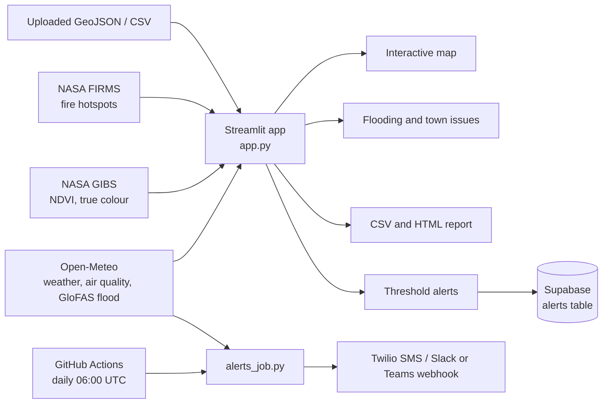
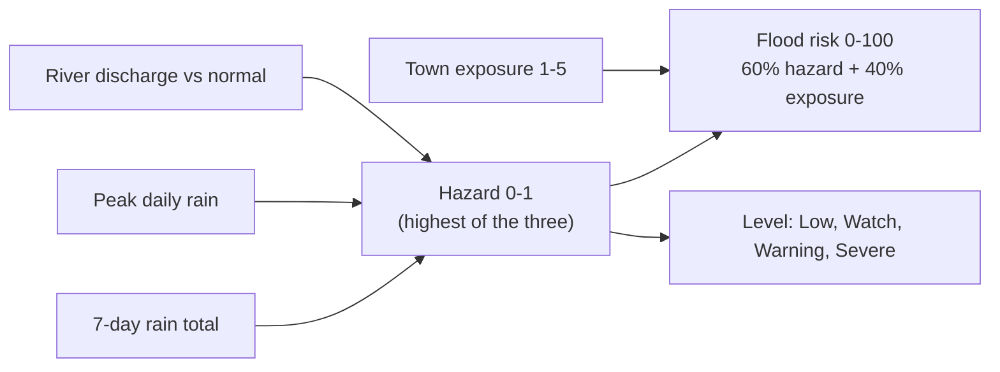

<p align="center">
  
</p>

<h1 align="center">Gambia Environmental GIS Dashboard</h1>

<p align="center">
  Live flood outlook, air quality, heat, fire and vegetation monitoring for The Gambia 🇬🇲
</p>

<p align="center">
  
  
  
</p>

<!-- Add a screenshot: save it as docs/screenshot.png, then uncomment -->
<!-- <p align="center"></p> -->

## Features

- **Flood outlook:** 7-day flood level for 15 towns (Low / Watch / Warning / Severe), plus click-anywhere flood hazard on the map.
- **Live conditions:** temperature, humidity, wind, rainfall, PM2.5, PM10, Saharan dust and AQI for 8 regions.
- **Satellite layers:** NASA MODIS NDVI vegetation and true-colour imagery (GIBS), fire hotspots (FIRMS).
- **Town issue profiles:** the main environmental problems of each town (indicative; verify with NEA / NDMA / DWR).
- **Alerts:** on-screen thresholds, optional Supabase logging, daily SMS / webhook alerts.
- **Reports:** CSV export and a printable HTML report.
- **White-label:** client name, logo, colour and optional access code.
- **Custom layers:** upload GeoJSON, or CSV with `lat`, `lon`, `name`.

## Workflow



### How flood risk is calculated



## Quick start

```bash
git clone https://github.com/<your-username>/gambia-env-gis.git
cd gambia-env-gis
pip install -r requirements.txt
streamlit run app.py
```

## Configuration (all optional)

Copy `.streamlit/secrets.toml.example` to `.streamlit/secrets.toml`, or paste the values into Streamlit Cloud under Settings > Secrets. **Never commit `secrets.toml`.**

| Key | Purpose |
|---|---|
| `ORG_NAME`, `ORG_LOGO_URL`, `PRIMARY_COLOR` | White-label branding |
| `APP_PASSWORD` | Access code (remove for a public app) |
| `FIRMS_KEY` | Fire hotspots. Free at https://firms.modaps.eosdis.nasa.gov/api/map_key |
| `SUPABASE_URL`, `SUPABASE_KEY` | Log alerts to Supabase (anon key) |

### Supabase table

```sql
create table alerts (
  id bigint generated always as identity primary key,
  created_at timestamptz default now(),
  region text, type text, value float8, threshold float8
);
alter table alerts enable row level security;
create policy "insert alerts" on alerts for insert with check (true);
```

### Daily alerts

`alerts_job.py` runs on a schedule through `.github/workflows/alerts.yml`. Add these as GitHub repository secrets: `TWILIO_SID`, `TWILIO_TOKEN`, `TWILIO_FROM`, `ALERT_RECIPIENTS` (comma-separated, e.g. `+220...`), `WEBHOOK_URL`, `ORG_NAME`. The job has no memory between runs, so a long-lasting problem is re-sent each day.

## Project structure

```
app.py                      Streamlit dashboard
alerts_job.py               Scheduled alert sender
requirements.txt
assets/logo.svg             Logo
.github/workflows/alerts.yml
.streamlit/secrets.toml.example
PROPOSAL_AND_HANDOVER.md    Client proposal and handover checklist
```

## Data sources and limits

- **Open-Meteo** (weather, CAMS air quality, GloFAS flood): the free API is for **non-commercial** use. Commercial deployments need a paid plan.
- **NASA GIBS and FIRMS:** free; FIRMS needs a MAP_KEY.
- **OpenStreetMap tiles:** fair-use policy applies.
- Flood levels are forecast-based indicators, **not official warnings**. Tides, storm surge and street drainage are not modelled.
- Town exposure scores and issue lists are indicative assessments, not official data.

## Author

**Sulayman Bah**, ML / software developer, The Gambia
GitHub: [bahsulayman689-hash](https://github.com/bahsulayman689-hash) · LinkedIn: [sulayman-bah-8a7096423](https://linkedin.com/in/sulayman-bah-8a7096423)
