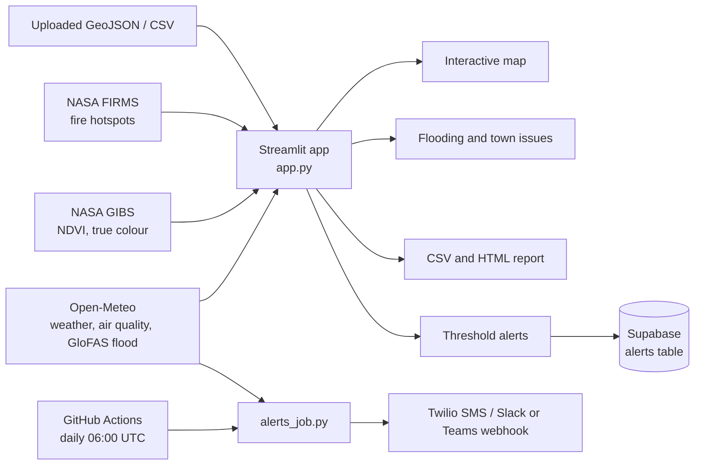
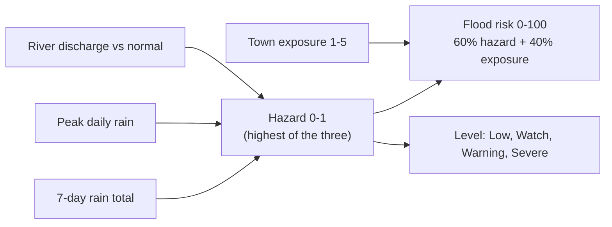

<p align="center">
  
</p>

<h1 align="center">Gambia Environmental GIS Dashboard</h1>

<p align="center">
  Live flood outlook, air quality, heat, fire and vegetation monitoring for The Gambia 🇬🇲
</p>

<p align="center">
  
  
  
</p>

<!-- Add a screenshot: save it as docs/screenshot.png, then uncomment -->

<!-- <p align="center"></p> -->

## Features

- **Flood outlook:** 7-day flood level for 15 towns (Low / Watch / Warning / Severe), plus click-anywhere flood hazard on the map.
- **Live conditions:** temperature, humidity, wind, rainfall, PM2.5, PM10, Saharan dust and AQI for 8 regions.
- **Satellite layers:** NASA MODIS NDVI vegetation and true-colour imagery (GIBS), fire hotspots (FIRMS).
- **Town issue profiles:** the main environmental problems of each town (indicative; verify with NEA / NDMA / DWR).
- **Alerts:** on-screen thresholds, optional Supabase logging, daily SMS / webhook alerts.
- **Reports:** CSV export and a printable HTML report.
- **White-label:** client name, logo, colour and optional access code.
- **Custom layers:** upload GeoJSON, or CSV with `lat`, `lon`, `name`.

## Workflow



### How flood risk is calculated



## Quick start

```bash
git clone https://github.com/<your-username>/gambia-env-gis.git
cd gambia-env-gis
pip install -r requirements.txt
streamlit run app.py
```

## Configuration (all optional)

Copy `.streamlit/secrets.toml.example` to `.streamlit/secrets.toml`, or paste the values into Streamlit Cloud under Settings > Secrets. **Never commit `secrets.toml`.**

| Key                                               | Purpose                                                                 |
| ------------------------------------------------- | ----------------------------------------------------------------------- |
| `ORG_NAME`, `ORG_LOGO_URL`, `PRIMARY_COLOR` | White-label branding                                                    |
| `APP_PASSWORD`                                  | Access code (remove for a public app)                                   |
| `FIRMS_KEY`                                     | Fire hotspots. Free at https://firms.modaps.eosdis.nasa.gov/api/map_key |
| `SUPABASE_URL`, `SUPABASE_KEY`                | Log alerts to Supabase (anon key)                                       |

### Accounts (sign in / create account)

With `SUPABASE_URL` and `SUPABASE_KEY` set, the app shows a **Sign in / Create account** page (Supabase Auth). Set `REQUIRE_LOGIN = "false"` to keep the app public. Without Supabase, `APP_PASSWORD` is used as a simple access code.

In Supabase: **Authentication > Providers > Email** must be enabled. Under **Authentication > URL Configuration**, set **Site URL** to your Streamlit app URL so confirmation and reset links come back to the app. To restrict access to invited users only, turn off new sign-ups and use **Authentication > Users > Invite user**.

### Incident reports table

Signed-in users can report real damage (type, severity, houses and people affected, location). Run this once in the Supabase SQL Editor:

```sql
create table incidents (
  id bigint generated always as identity primary key,
  created_at timestamptz default now(),
  reporter_email text, type text, severity text, description text,
  lat float8, lon float8, town text,
  houses_affected int default 0, people_affected int default 0
);
alter table incidents enable row level security;
create policy "read incidents" on incidents for select to authenticated using (true);
create policy "insert incidents" on incidents for insert to authenticated with check (true);
```

Reports appear as coloured dots on the map (yellow minor, orange moderate, red severe). Sessions last about an hour; if saving fails, sign out and in again.

### Incident photos (optional)

Run once in the Supabase SQL Editor:

```sql
alter table incidents add column photo_url text;
insert into storage.buckets (id, name, public) values ('incident-photos', 'incident-photos', true);
create policy "upload photos" on storage.objects for insert to authenticated
  with check (bucket_id = 'incident-photos');
```

Photos are public by URL, so tell reporters not to photograph faces or private documents. If a photo fails to upload, the whole report is not saved.

### Exposure (buildings near a point)

Click the map or press **Estimate for all towns** on the flooding tab to count mapped OpenStreetMap buildings within 1 km (Overpass API, no key, cached 7 days). OSM coverage varies, so treat it as a proxy, not a population count.

### Sentinel-2 tab

Searches Sentinel-2 L2A scenes through the Earth Search STAC API (AWS, no key) and reads only a small window of each scene, so it fits Streamlit Community Cloud. Shows true colour, cloud-masked NDVI, vegetation share and an NDVI trend. Needs `rasterio` (in `requirements.txt`). Keep the area small or the detail on Fast/Medium; the Full 10 m mode with a 20 km area reads about 1200 x 1200 pixels per band.

### Profile photos (person in charge)

Run once in the Supabase SQL Editor. Each user can only write to their own folder:

```sql
insert into storage.buckets (id, name, public) values ('avatars', 'avatars', true);
create policy "avatar insert" on storage.objects for insert to authenticated
  with check (bucket_id = 'avatars' and (storage.foldername(name))[1] = auth.uid()::text);
create policy "avatar update" on storage.objects for update to authenticated
  using (bucket_id = 'avatars' and (storage.foldername(name))[1] = auth.uid()::text);
```

Signed-in users upload from the sidebar (**Change profile photo**). The photo is cropped to a square, resized to 256 px and shown in a circle in the sidebar and the top banner. Without sign-in the photo lasts only for the current session.

### Data quality log

The **Data quality** tab checks source health, FIRMS cross-sensor agreement and fire reports against satellite detections. To save snapshots and see trends, run once in the Supabase SQL Editor:

```sql
create table data_quality_log (
  id bigint generated always as identity primary key,
  created_at timestamptz default now(),
  source text, metric text, value float8, note text
);
alter table data_quality_log enable row level security;
create policy "read dq" on data_quality_log for select to authenticated using (true);
create policy "insert dq" on data_quality_log for insert to authenticated with check (true);
```

These checks measure consistency and agreement. They are not an absolute accuracy score.

### Farm monitor (locate a farm)

Search a village, enter coordinates, or draw the field on a satellite photo (polygon, rectangle or marker). The app then shows rain since planting, days without rain, soil moisture, a rain and soil chart, Sentinel-2 NDVI measured only inside the field, and alerts (dry spell, dry soil, heat, heavy rain, NDVI drop). Saving farms needs sign-in and this SQL, run once in the Supabase SQL Editor:

```sql
create table farms (
  id bigint generated always as identity primary key,
  created_at timestamptz default now(),
  owner uuid default auth.uid(),
  name text, crop text, planting_date date,
  lat float8, lon float8, area_ha float8, geojson text
);
alter table farms enable row level security;
create policy "own farms read" on farms for select to authenticated using (owner = auth.uid());
create policy "own farms insert" on farms for insert to authenticated with check (owner = auth.uid());
create policy "own farms delete" on farms for delete to authenticated using (owner = auth.uid());
```

Each user sees only their own farms. Satellite photo tiles come from Esri World Imagery; check its terms before commercial use.

### Compare over time

The **Compare over time** tab (1) compares up to 4 places (towns, your saved farms, or a custom point) month by month for rainfall, temperature, soil moisture, evapotranspiration, wind or Sentinel-2 NDVI, over 1 to 10 years, as side-by-side lines, year-over-year lines or difference from normal, with a latest-12-months vs earlier-years table; and (2) maps how one place changed between two date ranges using the clearest Sentinel-2 scene in each. History comes from the Open-Meteo archive (model reanalysis, not station measurements).

### Farm analysis

For a located farm the **Farm monitor** tab also shows: this season's rain against earlier seasons over the same days after planting; a zone map inside the field (clearly weaker, typical, clearly stronger greenness from Sentinel-2); a before/after change map of the field; and, for signed-in users with several saved farms, a ranking of which farm has the most weather stress. All thresholds are indicative.

### Supabase table

```sql
create table alerts (
  id bigint generated always as identity primary key,
  created_at timestamptz default now(),
  region text, type text, value float8, threshold float8
);
alter table alerts enable row level security;
create policy "insert alerts" on alerts for insert with check (true);
```

### Daily alerts

`alerts_job.py` runs on a schedule through `.github/workflows/alerts.yml`. Add these as GitHub repository secrets: `TWILIO_SID`, `TWILIO_TOKEN`, `TWILIO_FROM`, `ALERT_RECIPIENTS` (comma-separated, e.g. `+220...`), `WEBHOOK_URL`, `ORG_NAME`. The job has no memory between runs, so a long-lasting problem is re-sent each day.

## Project structure

```
app.py                      Streamlit dashboard
alerts_job.py               Scheduled alert sender
requirements.txt
assets/logo.svg             Logo
.github/workflows/alerts.yml
.streamlit/secrets.toml.example
PROPOSAL_AND_HANDOVER.md    Client proposal and handover checklist
```

## Data sources and limits

- **Open-Meteo** (weather, CAMS air quality, GloFAS flood): the free API is for **non-commercial** use. Commercial deployments need a paid plan.
- **NASA GIBS and FIRMS:** free; FIRMS needs a MAP_KEY.
- **OpenStreetMap tiles:** fair-use policy applies.
- Flood levels are forecast-based indicators, **not official warnings**. Tides, storm surge and street drainage are not modelled.
- Town exposure scores and issue lists are indicative assessments, not official data.

## Author

**Sulayman Bah**, ML / software developer, The Gambia
GitHub: [bahsulayman689-hash](https://github.com/bahsulayman689-hash) · LinkedIn: [sulayman-bah-8a7096423](https://linkedin.com/in/sulayman-bah-8a7096423)
